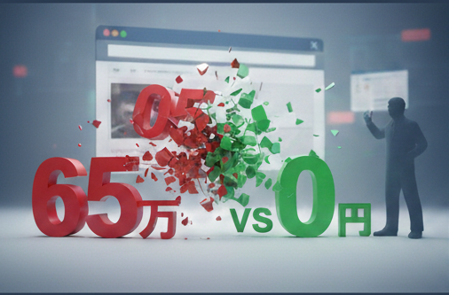

## はじめに：生成AI が見つけた「古さ」

HPのリニューアルを本気で考えるきっかけは、思いがけない場所からやってきました。

もし、あなたが「うちのサイト、古いな」と薄々感じていながらも、予算の現実に二の足を踏んでいる中小企業の経営者なら、この話は他人事ではないかもしれません。

それは、Claude に現在のサイトを見てもらったときのことです。

「試しに生成AIに診断してもらったら、どう見えるんだろう」

そんな軽い気持ちで、うちの HP を Claude に見せました。

返ってきた評価は、予想より客観的でした。

---

## 第1章：Claude の診断 — 古さを指摘される衝撃

Claude からの診断は、こんな内容でした：

**現在のサイトの課題：**
- デザインが古く、視覚的なインパクトが弱い
- モバイル対応が不十分
- 会社の技術力や実績が効果的に伝わらない
- ナビゲーションが不明確
- コンテンツが限定的

正直な話、これを読んだときの感情は複雑でした。

自分自身で、このサイトが古くなってきているという自覚はありました。でも、同業他社のサイトを見ても、特に洗練されたものが多くあるわけではなく、「製造業のサイトはこんなもんだ」という感覚で放置していたのです。目の前の製造業務が優先で、リニューアルは「いつか必要になったら考えよう」くらいの優先度でした。

ところが、生成AIから客観的に指摘されると、話は違います。

「さすがになんとかせんといけない」

そう思わせるだけの、説得力がありました。

---

## 第2章：Gemini の見積もり — 数十万円 + 月々保守費用

では、具体的にどうするのか。

同じく Gemini に「リニューアルに必要な費用」を聞いてみました。

返ってきた見積もりは、こんな内容でした：

**WordPress リニューアルプランの概算**
- 企画・設計：10～20万円
- デザイン制作：20～40万円
- コーディング・システム構築：30～60万円
- サーバー・ドメイン設定：5～10万円

**合計：65～130万円程度**

**月額保守費：1～3万円程度**

数字を見た瞬間、現実が重くのしかかってきました。

「このコストは、うちには払えない」

それが、正直な判断でした。

零細製造業の経営者として、年間で数十万円の HP 運用費があるわけではありません。新しい設備投資、人件費、材料費—すべてが優先順位の上にあります。65 万円から 130 万円という金額は、私たちにとって、決して小さくない投資です。

加えて、月々の保守費用。HP を改善して終わりではなく、継続的に月 1～3 万円のコストが発生する。その覚悟が、当時の私たちにはありませんでした。

---

## 第3章：「では無料で何とかできないか」という発想転換

ここで、一つの選択肢が浮かびました。

「では、無料ツールで何とかできないか」

理由は単純です。

Claude と Gemini からの指摘が正しいなら、「何もしない」という選択肢はない。でも、65 万円の予算もない。ならば、無料で何とかする以外にない。

それが、発想転換の始まりでした。

当時、私は既に Claude の無料チャットを使っていました。AI が何ができるのか、どう活用できるのか、まだ手探りの段階でしたが、「ひょっとして、これでサイトの改良ができるのでは」という、ぼんやりとした期待はありました。

「完全に無料で実装する」というのは、現実的ではないかもしれない。でも、「大幅に費用を削減しながら、何とか改良する」という道はあるかもしれない。

その判断が、今回のリニューアルプロジェクトの出発点になったのです。

---

## 第4章：既存のサブスク費用と継続コスト

ここで、現実的な話をしておく必要があります。

「無料で実装する」というのは、完全にゼロから始めるわけではありません。すでに、私たちは毎月いくつかのサービスに費用を払っていました：

- **サーバー費用（Lolipop エコノミー）**
- **ドメイン費用（.co.jp）**
- **Google Workspace（Business Starter）**
- **Microsoft 365 Apps for business**

特に、.co.jp ドメインの維持は重要です。製造業において、.co.jp は「法人である」という信頼の証です。その信頼性を保ちながら、中身を新しくするという判断は、経営者として賢明だと考えています。リニューアルで見た目を変えても、信頼の基盤（.co.jp）は揺るがさない。それは取引先に対する約束でもあります。

これらは HP リニューアルとは関係なく、ビジネス運営のために必要なコストです。つまり、「無料で実装する」というのは、これらの既存費用の上に、追加のコストをいかに抑えるかという話なのです。

65～130 万円という見積もりは、ほぼゼロの状態から高機能な HP を構築する費用でした。

一方、私たちの場合は、既にサーバーもドメインも持っていて、Google Workspace も使っていて、基本的な IT インフラは揃っていました。その上で、「生成AI を含む無料ツールをどこまで活用できるか」という戦い方ができたのです。

---

## おわりに：費用制約から始まる選択

HP のリニューアルという経営課題に直面したとき、私たちの選択肢は大きく分かれていました：

1. **外注する選択**：65～130 万円の投資で、プロの完成度を手に入れる
2. **何もしない選択**：現状を受け入れ、古いサイトのまま運営を続ける
3. **自社で何とかする選択**：予算制約の中で、無料ツールを活用して改良する

正直なところ、選択肢 1 は経営判断としては理想的でした。プロの手で完全にリニューアルされたサイトは、確実に企業の信頼度を上げます。

でも、現実は予算が限定的です。

選択肢 3 を選んだのは、強気な決断というより、「これ以外に道がない」という消極的な判断からでした。

しかし、その消極的な決断の中に、予期しない可能性が隠れていたことに、後から気がつくことになります。

無料ツールの活用という制約の中で、何をどう実装するのか。その試行錯誤の過程で、私たちは生成AI をビジネスの中心に据える実装方法を学ぶことになったのです。

それは、後々の大きな資産になることになります。

---

**次の記事では、その「無料ツール活用」の実装と、そこから見えてきた「情報との向き合い方」、そして「時間効率」という判断軸について、記録していきます。**
