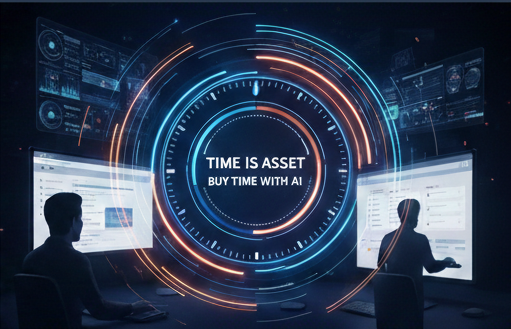

## はじめに：「完全無料」という幻想

前編では、65～130万円の外注見積もりに直面して、「無料ツールで何とかする」という選択をしたことを記しました。

ここで、誤解のないように最初に言っておきたいことがあります。

「完全無料でリニューアルができた」というわけではありません。

実装を始めてすぐに、その現実に直面することになったのです。

---

## 第1章：無料で揃ったツール群

プロジェクトを開始したとき、私たちが活用できる無料ツールは、想像以上に多くありました。

- **Claude**（無料チャット版）
- **Gemini**（画像生成）
- **Copilot**
- **Unsplash**（高品質な画像素材）
- **VS Code**（テキスト・コード編集）

これらのツールだけでも、かなりのことができます。

Claude に「このセクションはどう改良したらいいか」と聞けば、提案をもらえる。Gemini で「製造業っぽい画像を作ってほしい」と言えば、イメージに近い画像が生成される。Unsplash から無料でダウンロードできる高品質な写真も、プロっぽい雰囲気を作るのに役立ちます。

最初の数日間は、この無料ツールだけで「こんなに進むんだ」という感動がありました。

予算ゼロで、ここまでできるんだ——そう思っていました。

---

## 第2章：それでも有料化した理由（Claude 月 $20）

その感動は、3日目で現実に叩き落とされました。

Claude の無料版には、利用回数に制限があります。

「次の時間まで待機してください」というメッセージが表示されるようになったのです。

その瞬間、作業は完全に停止しました。

---

### 待機時間が生む非効率

ここで何が起きたかというと、単なる「時間の停止」ではなく、「思考の中断」が起きたのです。

今やっている改良案について、Claude に「どう思う？」と相談しながら進めていたプロジェクト。その相談相手が突然いなくなってしまいました。

次の時間まで待つ間、私は何をしたか。

他の業務に移る。でも、数時間後に「あ、さっきの Claude との相談を続けたい」と思っても、別の案件に頭が切り替わっている。効率が落ちます。

さらに、せっかくのモチベーションも下がってきます。

「こういう小さなストレスの積み重ねが、大きなプロジェクトの挫折につながるんだろうな」

そう思いました。

---

### 月 $20（約 4 千円弱）という判断

その時点で、私は Claude の有料版（Claude Pro）を契約することに決めました。

月4千円程度（20ドル）です。

経営者としての判断は、シンプルでした：

「この4千円で、作業が中断されず、思考が連続する。それで、改良の質と速度が上がるなら、投資として成立する」

65～130万円の外注費用に比べれば、月4千円は微々たるものです。でも、その4千円が、プロジェクト全体の効率を大きく変えたのです。

---

## 第3章：情報との向き合い方（能動 vs パッシブ）

プロジェクトを進める中で、別の重要なことに気がつきました。

それは、「情報の流し込み方」についてです。

### 「情報過多のまま」という戦略

私は、Feedly というサービスで、毎日大量の情報を流し込んでいます。

登録しているカテゴリは、仕事に直結するものばかりではありません：

**仕事関連：**
- 建築体験
- iPhone
- 製造業
- パソコン関連
- アプリ紹介
- プログラミング

**教養・読み物：**
- ビジネス
- 文具
- 自動車
- スポーツ
- 自転車

更新頻度も、毎日から「時々更新」までバラバラです。

つまり、毎日、大量の「関連あるか不明な情報」が流れてくるわけです。

一般的には、これは「効率が悪い」と見なされます。

「本当に必要な情報だけを、的確に取ってくるべき」という考え方が、情報時代の常識かもしれません。

---

### なぜ「情報過多のまま」なのか

でも、私はあえてこのやり方を続けています。

理由は、シンプルです。

能動的に「これを探す」と決めて探していると、視野が狭まるのです。

「HP リニューアル」という課題について、「HP リニューアル」というキーワードだけで検索していたら、一定の範囲の情報しか手に入りません。

一方、Feedly で「スポーツ」や「文具」の記事も流れてくる中で生活していると、予期しない視点が目に入るのです。

「あ、この戦術の考え方は、Web デザインにも応用できるかも」
「自動車の安全設計の考え方、製品PR にも使えそうだ」

そういう、一見無関係に見える情報が、実は課題解決の突破口になることがあるのです。

---

### 「Claude で HP を作る」という記事との出会い

実は、このプロジェクトの起動のきっかけになった「Claude で HP を作る」という記事も、その流れの中で出会いました。

記憶は定かではないのですが、Feedly で流れてきた、一見関係ないようなサイトから、その記事にたどり着いたのだと思います。

「生成AI で HP が作られている」「そういう方法もあるのか」

その記事を読んだ瞬間、「だったら、うちもやってみようか」という気持ちが湧いてきました。

もし、「HP リニューアル」というキーワードだけで目的的に情報を探していたら、その記事には出会わなかったかもしれません。

---

## 第4章：費用対効果の判断軸（時間効率視点）

では、ここまでの投資を、どう評価するのか。

### 65万円の外注費用 vs 月 4 千円の投資

前編で触れた、65～130万円の外注見積もり。

それに対して、私たちが投じた費用は：

- **Claude Pro：月 $20（約 4 千円）**
- **その他の無料ツール：月 0 円**

単純に考えると、65～130万円の節約に成功した、ということになります。

でも、本当にそうなのか。

---

### 「時間」という隠れたコスト

経営者として考えるべきは、「お金」だけではなく、「時間」です。

HP リニューアルに、私自身がどれだけの時間を費やしたのか。その時間を、本来の製造業務に充てていたら、どれだけの売上が出たのか。

また、完全に自分で実装することで、学習コストが生まれました。HTML、CSS、生成AI の活用方法——それらを学ぶのに、かなりの時間をかけました。

外注していたら、「プロにお任せして、その間は他の業務をしていた」という選択肢がありました。

その点では、外注の方が「時間を買う」という意味では合理的だったかもしれません。

---

### それでも「月 4 千円の投資」を選んだ理由

にもかかわらず、私は月 4 千円の Claude Pro を契約することを選びました。

理由は：

「そのお金で、作業が中断されず、思考が連続するなら、価値がある」

ということに、尽きます。

完全無料で実装しようとすると、待機時間に思考が中断される。その中断が、意思決定の遅延や、修正作業の増加につながる。

その結果、「本当は 2 週間で終わる案件が、3 週間かかった」みたいなことが起きてしまいます。

月 4 千円で、その非効率を解消できるなら、それは投資として成立する——そう判断したわけです。

さらに言えば、自分で作ったからこそ、今後の更新や改良が自由自在になった。機能を追加したい、デザインを微調整したい、そう思ったときに、外注に頼らず自分たちで対応できる。その長期的な自由度と素早い対応能力は、何物にも代え難いメリットなのです。

---

## おわりに：「予算がない」ではなく「予算の使い方を変える」

このプロジェクトを通じて、学んだことがあります。

それは、「完全無料で何かをする」というのは、現実的ではないということです。

でも、同時に「65万円の投資は不可能」というのも現実です。

ならば、どうするのか。

**「予算がない」という状況の中で、「どこに投資するか」を選ぶ。**

その選択が、全体の効率を決めるのです。

私たちの場合：
- 外注の 65～130万円には投資しない
- でも、Claude Pro の月 4 千円には投資する
- Unsplash などの無料ツールは活用する
- Feedly で情報を流し込み、予期しない発見を待つ

その組み合わせの中で、「完全無料ではないが、大幅に費用を削減しながら、質の高い改良ができた」というのが、実装の実感です。

---

**零細製造業の経営者として、限られた予算の中で、何をするのか、何をしないのかを判断する。**

その判断の一つの事例として、このプロジェクトの記録を残しておきたいと思いました。

HP のリニューアルを考えている他の中小企業の経営者が、「あ、こういうやり方もあるのか」と参考にしてくれたら、幸いです。
